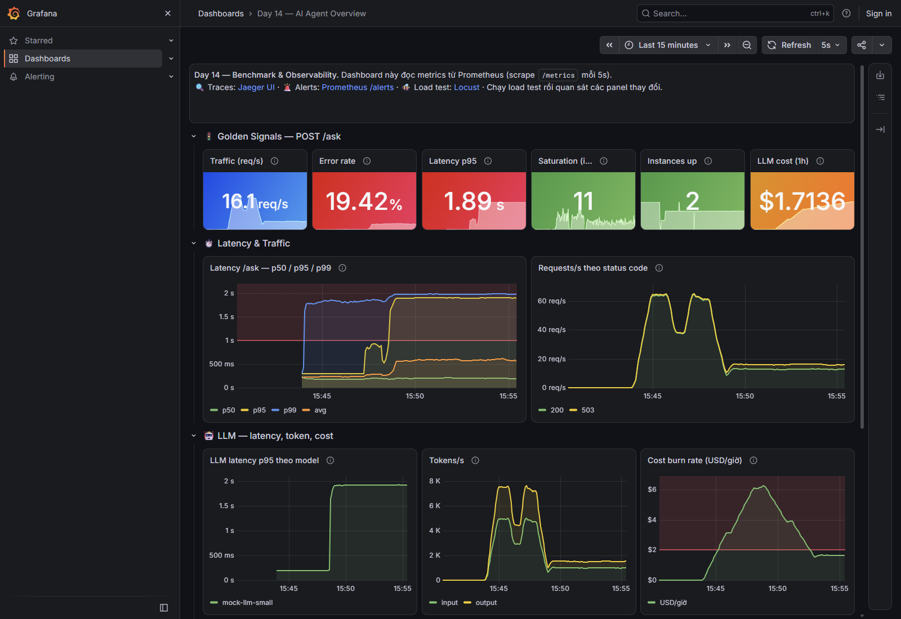
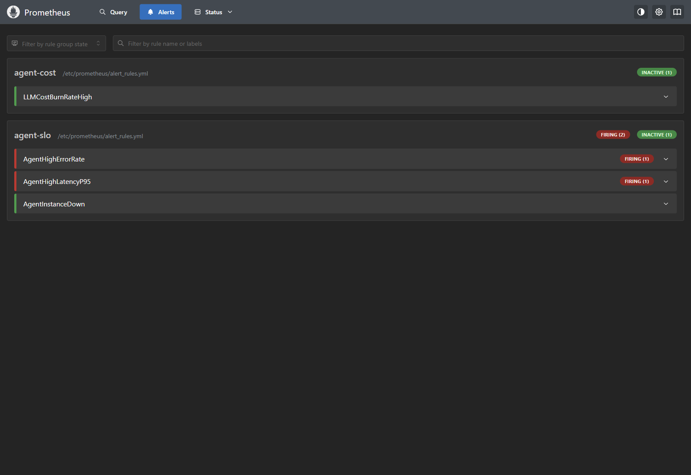
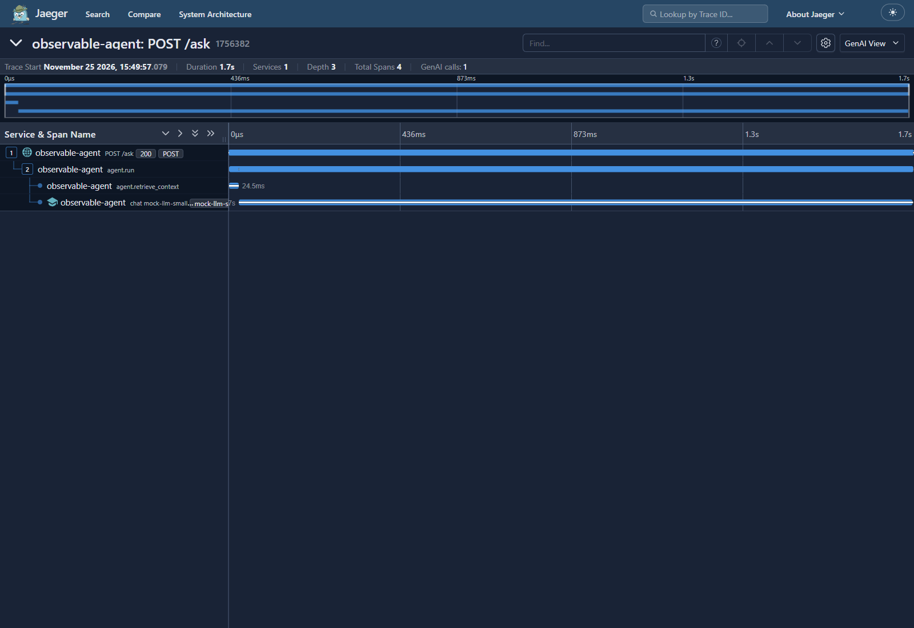
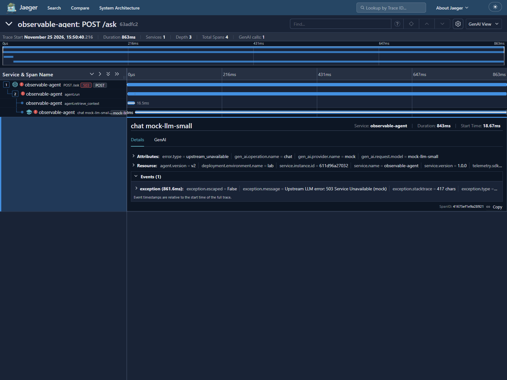

# Benchmark & Observability Report — Day 14

**Họ tên:** Nguyễn Bá Quang — MSSV 2A202603555  
**Ngày chạy:** 25/11/2026  
**Môi trường:** Windows host, Ubuntu WSL2 Python 3.12, Docker Desktop Linux Engine 28.3.2; [cấu hình đo được](evidence/environment.json). Mock LLM, không gọi LLM thương mại.

## 1. SLO và phương pháp

| SLI | SLO | Lý do |
|---|---|---|
| p95 `/ask` | ≤ 500 ms | Mục tiêu phản hồi tương tác trong lab |
| Error rate `/ask` | ≤ 2% | Mock mặc định khoảng 1% lỗi, có khoảng dự phòng |
| Accuracy | ≥ 85% trong CI; bản sửa cuối 100%, không regression | Chặn giảm chất lượng và đáp ứng yêu cầu 23/23 |

Load test mỗi lượt 300 request, warm-up không tính; latency trong report của script tính trên response 200, error rate tính tất cả request. Concurrency 1/10/50/100 dùng v2 và mặc định slow 0.03/error 0.01. So sánh slow rate giữ concurrency 20 và 300 request. Eval tắt lỗi ngẫu nhiên (`MOCK_ERROR_RATE=0`), còn slow rate mặc định; 23 mẫu eval không đủ kết luận latency.

Lượt load cuối chạy sau khi dừng stack quan sát và hết các job build của bài, tránh trộn ảnh hưởng build image vào so sánh slow rate. Các dịch vụ sẵn có của người dùng không bị tắt. Đây là số đo một máy và một lượt ngẫu nhiên cho mỗi cấu hình, không phải kết luận capacity production.

## 2. Benchmark hiệu năng

### 2.1 Concurrency

| Concurrency | RPS | p50 ms | p95 ms | p99 ms | Error rate | SLO |
|---|---:|---:|---:|---:|---:|---|
| 1 | 4.29 | 194.0 | 228.4 | 1695.8 | 0.67% | PASS |
| 10 | 40.74 | 189.0 | 223.5 | 1676.0 | 1.67% | PASS |
| 50 | 107.98 | 215.4 | 317.2 | 1710.8 | 1.00% | PASS |
| 100 | 49.33 | 533.1 | 3732.1 | 4168.6 | 1.00% | FAIL |

File nguồn: `reports/load_v2_c1.json`, `load_v2_c10.json`, `load_v2_c50.json`, `load_v2_c100.json`. Không thay số khi một lượt FAIL. RPS phụ thuộc concurrency, event loop, CPU, I/O/log và thời gian chờ LLM; không tăng vô hạn theo số client. Với chỉ 300 mẫu và slow rate 3%, số mẫu chậm thực tế có thể vượt 5%, khiến cả p95 tăng dù cấu hình mặc định không đổi.

### 2.2 Tail latency

| MOCK_SLOW_RATE | avg ms | p95 ms | p99 ms |
|---|---:|---:|---:|
| 0 | 190.0 | 219.2 | 226.1 |
| 0.03 | 231.7 | 223.2 | 1694.3 |
| 0.1 | 331.8 | 1700.3 | 1719.7 |

p99 nhạy với vài request chậm; khi tỷ lệ slow vượt 5%, p95 cũng phản ánh nhóm này. Average làm loãng trải nghiệm nhóm chậm bằng nhiều request nhanh. Histogram/SLO phải giữ cả p95/p99 và error rate; không chỉ dùng average. Số đo có jitter, scheduling và độ bất định do mẫu hữu hạn.

### Exercise 7.1 — Metrics

Counter: `http_requests_total`, `llm_tokens_total`; Gauge: `agent_in_flight_requests`; Histogram: `http_request_duration_seconds`. Đã thêm Histogram **`agent_question_length_chars`** và observe `len(body.question)` trong bản develop, bucket 20/50/100/200/500/1000/2000, không gắn mỗi độ dài thành label. Bằng chứng scrape: [develop-metrics.txt](evidence/develop-metrics.txt).

Middleware lấy route template và gán `unmatched` cho URL lạ. Dùng raw URL khi bot quét hàng nghìn đường dẫn sẽ tạo hàng nghìn time series, tăng RAM/storage và chi phí query; không thêm user_id/question/request_id làm label.

## 3. Benchmark chất lượng

| Chỉ số | v1 | v2 ban đầu | v2 sửa KB |
|---|---:|---:|---:|
| Accuracy | 4.35% (1/23) | 91.30% (21/23) | 100.00% (23/23) |
| Avg tokens/câu | 57.1 | 109.1 | 113.7 |
| Tổng cost USD | 0.000404 | 0.000762 | 0.00079 |
| Cost/câu đúng USD | 0.00040395 | 3.627e-05 | 3.436e-05 |
| Quality gate | FAIL | PASS | PASS |

| ID sai ban đầu | Thiếu kiến thức/keyword | Sửa |
|---|---|---|
| `scaling-03` | CPU, memory, custom metrics | Thêm entry Kubernetes/HPA/autoscaling |
| `security-02` | token, hết hạn, chữ ký | Thêm entry giải thích API key và JWT |

Bổ sung trong `develop/utils/mock_llm.py` và `production/utils/mock_llm.py`; không sửa golden dataset hoặc cách chấm. Restart agent rồi eval với baseline `eval_v2.json` và `--min-accuracy 1.0`: 23/23, không regression. Output `reports/eval_v2_fixed.json`.

v2 dùng retrieval nên prompt/context dài, token/cost mỗi câu cao hơn v1. Tuy nhiên cost/câu đúng giảm mạnh vì độ chính xác tăng. Những latency trong eval là mô tả mẫu nhỏ, không dùng thay load test.

CI ở [.github/workflows/eval.yml](.github/workflows/eval.yml): khởi động v2, chờ health, chạy evaluator với ngưỡng 0.85 và baseline bản sửa cuối. Exit code 1 làm job fail; cần bật required status check trong branch protection của repo để thực sự chặn merge. Job chưa được chạy trên GitHub trong phiên này; lệnh evaluator đã chạy local.

## 4. Observability stack

### 4.1 Dashboard và Exercise 7.4



Stack agent/Nginx/Prometheus/Grafana/Jaeger/Locust chạy bằng Docker Compose, project riêng `k5-day14-observability`. Cổng thực tế trên máy này: agent 18080, Grafana 3001, Prometheus 9090, Jaeger 16686, Locust 8089. Đã sửa Dockerfile mẫu thêm `PYTHONUSERBASE` cho package của user non-root.

Snapshot Prometheus sau scale 3: p95 **887.99 ms**, avg **285.05 ms**, error rate **0.86%**. Dữ liệu raw: [prometheus-scale-3.json](evidence/prometheus-scale-3.json). Các thời điểm screenshot và API snapshot khác nhau nên không buộc mọi số trên ảnh phải giống snapshot.

RPS từng instance ở snapshot cùng file cho thấy phân bố traffic; Nginx round-robin cân bằng số request tương đối, không đảm bảo số request đang xử lý hoặc độ trễ bằng nhau. Input tokens/s cao hơn output vì prompt gồm system instructions, câu hỏi và context retrieval. `/metrics` qua Nginx trả 404 theo config, để tránh public metric nội bộ; Prometheus scrape trực tiếp từng agent qua Docker network.

### 4.2 Chaos và alert

Hai thay đổi A+B được áp dụng cùng lúc để có hai alert firing đồng thời, bắt đầu **2026-11-25T08:48:02.241911+00:00**. Đồng hồ dùng monotonic từ trước lệnh recreate service, bao gồm thời gian deploy local; poll mỗi 2 giây nên thời điểm phát hiện có sai số poll và evaluation interval 5 giây.

| Thí nghiệm | Thay đổi | Alert | Thời gian tới firing | Panel |
|---|---|---|---:|---|
| A | `MOCK_ERROR_RATE=0.2` | AgentHighErrorRate | 111.06 s | Error rate |
| B | `MOCK_SLOW_RATE=0.3` | AgentHighLatencyP95 | 167.88 s | p95/p99 latency |
| C | Model lớn | Không chạy riêng | Không có số đo | Phân tích: token cost và cost burn rate tăng |
| D | Pause instance | Không chạy riêng | Không có số đo | Phân tích: `up=0`; lỗi 504 tại Nginx không nhất thiết được agent đếm |
| E | Đổi sang v1 | Không chạy chaos riêng; đã eval v1 | Không có số đo firing | Eval thấy accuracy thấp dù metric hạ tầng có thể xanh |



Raw: [alert-timing.json](evidence/alert-timing.json), [prometheus-alerts-firing.json](evidence/prometheus-alerts-firing.json), [PromQL lúc chaos](evidence/prometheus-chaos.json). Không dùng thời gian rule `for` làm thời gian đo: còn cửa sổ rate, scrape, evaluation và recreate. Rule tests: [alert-rules-test.log](evidence/alert-rules-test.log), kết quả SUCCESS. Sau thí nghiệm khôi phục default và dừng stack lab.

E là lỗi chất lượng: latency/error rate không đủ để phát hiện. Cần eval trước release, canary, synthetic golden questions, theo dõi feedback và lấy mẫu đánh giá câu trả lời trong production. Với D, cần thêm metrics Nginx hoặc external synthetic probe để thấy lỗi tại gateway.

### 4.3 Trace và log



- Trace ID: `1756382ce9fe2905f78008adb21a0899`.
- Tổng thời gian: **1745.146 ms**.
- Span LLM chậm nhất: `chat mock-llm-small`, **1716.219 ms**, **98.34%** tổng thời gian; đây là span công việc, không tính lại các parent span bao trùm nó.
- Trace chọn chậm nhất trong tập summary truy vấn có log tương ứng, không khẳng định chậm nhất mọi request từng chạy. Raw: [jaeger-slow-trace.json](evidence/jaeger-slow-trace.json).

Log JSON có cùng trace_id:

```json
{"ts": "2026-11-25T08:49:58.822513+00:00", "level": "INFO", "service": "observable-agent", "instance": "2b5ce935a4c4", "event": "llm_call", "trace_id": "1756382ce9fe2905f78008adb21a0899", "span_id": "d4b9469bd6c2d3d7", "request_id": "cebfc3c3206d", "model": "mock-llm-small", "agent_version": "v2", "input_tokens": 81, "output_tokens": 46, "cost_usd": 4e-05, "llm_ms": 1695.0}
```



Trace lỗi `63adfc2d1e00bceb8a11a2cc4fa6de58` có span lỗi và event exception. Raw: [jaeger-error-trace.json](evidence/jaeger-error-trace.json); correlation của cả hai: [trace-log-correlation.json](evidence/trace-log-correlation.json). Lỗi mock upstream được chuyển thành 503, không lộ stack trace cho client.

## 5. Scaling — Locust headless

Mỗi lượt 100 users, spawn rate 10/s, 2 phút, cùng model/version/default fault rate. Bảng dùng **dòng POST `/ask`** trong CSV; CSV cũng chứa `/health` và Aggregated, không trộn p95 giữa chúng.

| Instance | RPS `/ask` | p50 ms | p95 ms | p99 ms | Failures/requests |
|---|---:|---:|---:|---:|---:|
| 1 | 62.04 | 200 | 290 | 1700 | 66/7117 |
| 3 | 61.10 | 200 | 790 | 1700 | 65/6969 |

Nguồn: [scale_1_stats.csv](benchmark-results/scale_1_stats.csv), [scale_3_stats.csv](benchmark-results/scale_3_stats.csv). Full logs trong `evidence/locust-scale-*.log`. Locust trả exit 1 khi có lỗi mock; phải đọc số failure/status thay vì coi đó là lỗi chạy công cụ.

Trong lượt đo này, scale 3 **không cải thiện**: RPS từ 62.04 thành 61.10, p95 từ 290 thành 790 ms. p99 đều 1700 ms, cho thấy tail upstream vẫn tồn tại. Kết quả không chứng minh thêm replica luôn tốt; cần phân biệt hạn chế upstream, scheduling trên cùng host và tải thực tế trước khi tăng replica.

Locust mô phỏng người dùng nghỉ 0.5–2 giây sau mỗi tác vụ, nên RPS không tăng gấp ba chỉ vì tăng ba instance. App async chủ yếu chờ LLM, mỗi container giới hạn CPU 0.5/memory 256MB; scale giúp chia xử lý nhưng không loại bỏ tail latency của upstream. Phải xem cả panel LLM và tải máy trước khi kết luận nút thắt. Các lần chạy hữu hạn có lỗi/ngẫu nhiên khác nhau, không dùng chênh lệch nhỏ làm bằng chứng tối ưu chắc chắn.

## 6. Kết luận và giới hạn

1. Percentile cho thấy nhóm request chậm mà average che khuất; error rate cần theo dõi riêng vì latency chỉ tính request thành công.
2. Chất lượng phải được eval: tăng token mỗi câu có thể giảm chi phí mỗi câu đúng.
3. Kết hợp metric → trace → log cùng trace_id rút ngắn việc xác định lỗi nằm ở retrieval, model hay gateway.

Nếu triển khai thật: thêm metric ở gateway, timeout/retry và queue depth, burn-rate/error-budget theo nhiều cửa sổ, budget per-user, eval trên mẫu đa dạng và quản lý retention/sampling trace. Bộ 23 câu keyword chỉ kiểm tra hồi quy của lab, chưa đủ chứng minh chất lượng AI tổng quát. Chi phí là mô phỏng; không phát sinh bill LLM. Cloud vẫn chưa deploy, xem `DEPLOYMENT.md`.
