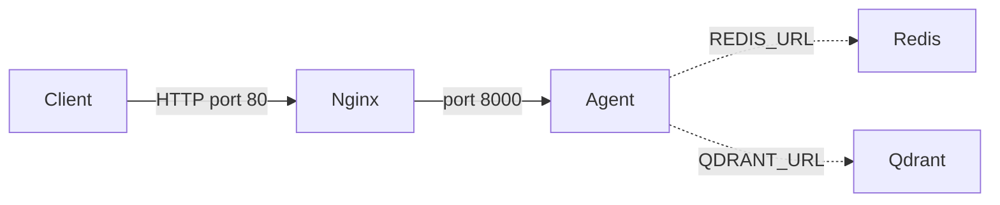

# Day 14 — Mission Answers

Các kết quả dưới đây lấy từ lệnh thật chạy trên Ubuntu WSL2 và Docker Desktop ngày 25/11/2026. Bằng chứng ở `evidence/`, `reports/`, `benchmark-results/`, `screenshots/`. Cloud đã deploy Railway: [https://k5-l3a-day14-nguyenbaquang-2a202603555-deploymen-production.up.railway.app](https://k5-l3a-day14-nguyenbaquang-2a202603555-deploymen-production.up.railway.app). Kết quả thật ở [public-check.json](evidence/public-check.json).

## Part 1 — Localhost vs Production

### Exercise 1.1 — Anti-patterns

1. `01-localhost-vs-production/develop/app.py:17`: hardcode API key mẫu; thay key thật vào đây sẽ làm lộ khi push repo.
2. Dòng 18: thông tin kết nối database kèm credential nằm trong source.
3. Dòng 21: bật debug cố định; môi trường production cần điều khiển bằng env.
4. Dòng 34: in API key vào log; log có thể được lưu lâu và nhiều người truy cập.
5. Dòng 51: bind `localhost`, khiến app không nhận kết nối từ ngoài container.
6. Dòng 52: cố định cổng 8000, không đọc `PORT` do nền tảng cấp.
7. Không có endpoint liveness/readiness và cleanup tài nguyên bằng lifespan.

### Exercise 1.2 — Chạy develop

`POST /ask?question=Hello` trả **200**. Bản develop nhận query, không nhận JSON. Chi tiết response thật: [local-exercises.json](evidence/local-exercises.json), mục `part1_develop`. Script tái hiện: `scripts/run_local_evidence.py`.

### Exercise 1.3 — So sánh

| Feature | Develop | Production mẫu | Vì sao quan trọng |
|---|---|---|---|
| Config | Hằng số trong source | `config.py` đọc env | Cùng code chạy dev/staging/prod, không rebuild để đổi cổng |
| Secret | Hardcode và in log | Đọc từ môi trường | Giảm nguy cơ lộ secret vào Git/log |
| Health/readiness | Không có | Có `/health`, `/ready` | Phân biệt process sống và sẵn sàng phục vụ |
| Logging | `print()` | Formatter JSON dạng chuỗi | Dễ thu thập; formatter mẫu chưa escape nội dung an toàn, Part 6 dùng `json.dumps` |
| Shutdown | Không có lifecycle cleanup | Có lifespan/signal demo | Hoàn tất request và giải phóng kết nối |
| Bind/port | localhost:8000 | Host/port đọc env | Nhận traffic trong container và dùng cổng cloud |

Bản production mẫu `/health` đã trả 200, xem `part1_production` trong JSON. Ví dụ mẫu cần chạy đúng entrypoint; không mặc định mọi đoạn minh hoạ đều là giải pháp production hoàn chỉnh.

## Part 2 — Docker

### Exercise 2.1 — Dockerfile

1. Base image thực tế của develop là **`python:3.11`**, theo Dockerfile, khác ví dụ đáp án slim trong tài liệu.
2. Working directory: **`/app`**.
3. Copy `requirements.txt` trước source để cache layer cài dependency; đổi source không buộc pip cài lại.
4. `CMD` cung cấp command/arguments mặc định và bị thay khi truyền command cho `docker run`. `ENTRYPOINT` định nghĩa executable chính; arguments runtime thường được nối vào và có thể thay executable bằng `--entrypoint`.

### Exercise 2.2–2.3 — Build, chạy và đo image

Build từ gốc repo:

```bash
docker build -f 02-docker/develop/Dockerfile -t my-agent:develop .
docker build -f 02-docker/production/Dockerfile -t my-agent:advanced .
docker image inspect my-agent:develop my-agent:advanced
```

| Image | Bytes từ Docker inspect | MB (10^6 bytes) | MiB (2^20 bytes) |
|---|---:|---:|---:|
| Develop | 426319963 | 426.32 | 406.57 |
| Production | 57409270 | 57.41 | 54.75 |

Giảm **86.53%**, tính `(develop - production) / develop × 100`. Đây là trường `Size` Docker Engine trên máy chạy, không dùng số ước lượng của README. Bằng chứng: [image inspect](evidence/part2-images.json), hai build log và [response container develop](evidence/part2-develop-response.json).

Builder cài compiler/dependencies; runtime chỉ nhận package và source cần chạy, dùng base slim và user non-root. Đã bổ sung `PYTHONUSERBASE=/home/appuser/.local` vào Dockerfile mẫu để Python non-root tìm đúng package sau khi copy từ builder.

### Exercise 2.4 — Compose và Nginx



Compose có agent, Redis, Qdrant và Nginx trong network `internal`; Redis/Qdrant có healthcheck và volume. Hai đường nét đứt biểu diễn cấu hình kết nối: app mẫu Part 2 chưa thực hiện retrieval hoặc lưu session qua hai backend này.

Stack `k5-day14-docker` đã build/start; `/health` và `POST /ask` qua Nginx đều 200. Xem [health](evidence/part2-nginx-health.txt), [ask](evidence/part2-nginx-ask.txt), `evidence/part2-stack-up.log`. Đã dừng và dọn volume của riêng stack lab sau khi test.

## Part 3 — Cloud Deployment

### Exercise 3.1/3.2 — Trạng thái

**Đã deploy Part 6 trên Railway**, project `zoological-tranquility`, environment `production`, cùng Redis private. Public URL: [https://k5-l3a-day14-nguyenbaquang-2a202603555-deploymen-production.up.railway.app](https://k5-l3a-day14-nguyenbaquang-2a202603555-deploymen-production.up.railway.app). Kiểm tra thật: GET `/health` 200, GET `/ready` 200, POST `/ask` thiếu key 401, có key 200. [JSON](evidence/public-check.json) · [Dashboard](screenshots/dashboard.png) · [Running](screenshots/running.png) · [Test](screenshots/test.png). API dùng mock LLM; `AGENT_API_KEY` xác thực ứng dụng. Xem [DEPLOYMENT.md](DEPLOYMENT.md).

### So sánh Railway và Render

| Mục | `railway.toml` | `render.yaml` |
|---|---|---|
| Định dạng | TOML, các bảng build/deploy | YAML, danh sách service |
| Build | `builder=DOCKERFILE`, Dockerfile tại root service | `runtime: docker`, `rootDir`, docker context/path |
| Health | `healthcheckPath=/health` | `healthCheckPath: /health` |
| Secret/Redis | Đặt Variables/reference trong dashboard | `generateValue` cho key, `sync: false` yêu cầu nhập Redis URL |
| Phạm vi | Cấu hình một service | Blueprint có thể mô tả nhiều tài nguyên; bản này dùng datastore tạo riêng |

Cả hai cấu hình đều đọc `PORT` qua CMD của Dockerfile và cần Redis thật trên cloud.

### Exercise 3.3 — Pipeline Cloud Run

`cloudbuild.yaml` mô tả cài dependency và chạy pytest, rồi build image gắn `$COMMIT_SHA` và `latest`.
Image được push lên registry trước khi `gcloud run deploy` triển khai revision mới ở `asia-southeast1`.
Lệnh deploy đặt tài nguyên, timeout, min/max instance và lấy secret từ Secret Manager.
`service.yaml` mô tả cấu hình tương đương bằng Knative YAML: image, concurrency, resource, env và probes.
Chưa chạy pipeline này: mẫu còn yêu cầu tests/requirements và thông tin project thật; file test step cũng cần fail-fast để không che lỗi pytest bởi lệnh echo cuối.

## Part 4 — API Security

### Exercise 4.1 — API key

FastAPI dependency kiểm tra header `X-API-Key` với `AGENT_API_KEY`; thiếu/sai key bị 401. Rotate bằng cách tạo key mới, cập nhật secret ở môi trường chạy và restart/redeploy; client chuyển sang key mới. Không log key.

HTTP output thật (header request có secret không được ghi ra file):

```http
HTTP/1.1 401 Unauthorized
date: Wed, 25 Nov 2026 08:01:57 GMT
server: uvicorn
content-length: 67
content-type: application/json

{"detail":"Missing API key. Include header: X-API-Key: <your-key>"}
```

```http
HTTP/1.1 200 OK
date: Wed, 25 Nov 2026 08:01:57 GMT
server: uvicorn
content-length: 114
content-type: application/json

{"question":"Hello","answer":"Agent đang hoạt động tốt! (mock response) Hỏi thêm câu hỏi đi nhé."}
```

### Exercise 4.2 — JWT

Đã lấy token qua `POST /auth/token` với tài khoản demo `student`, rồi dùng Bearer token cho `/ask`. Token không lưu trong bài. JWT gồm claims `sub`, `role`, `iat`, `exp`; server xác minh chữ ký HS256 và hạn dùng. API key đơn giản cho service; JWT mang danh tính/quyền/hạn dùng; OAuth2 dùng khi cần delegated authorization và tích hợp identity provider.

### Exercise 4.3 — Rate limiting

Mẫu Part 4 dùng deque timestamp theo user, xoá các request ngoài cửa sổ 60 giây: sliding-window log, dù comment đặt tên counter. User giới hạn 10 req/phút; admin không bypass hoàn toàn mà có bucket 100 req/phút. Chạy 20 request: **10 lần 200, sau đó 10 lần 429**.

```http
HTTP/1.1 429 Too Many Requests
date: Wed, 25 Nov 2026 08:02:00 GMT
server: uvicorn
x-ratelimit-limit: 10
x-ratelimit-remaining: 0
x-ratelimit-reset: 1795593780
retry-after: 59
content-length: 98
content-type: application/json
x-content-type-options: nosniff
x-frame-options: DENY
x-xss-protection: 1; mode=block
referrer-policy: strict-origin-when-cross-origin

{"detail":{"error":"Rate limit exceeded","limit":10,"window_seconds":60,"retry_after_seconds":59}}
```

Mẫu lưu trong RAM nên restart/multi-worker sẽ mất/chia riêng quota; bản Part 6 đã dùng Redis sorted set và Lua atomic cho mọi worker.

### Exercise 4.4 — Cost guard

Rate limit bảo vệ số lần gọi trong một khoảng thời gian; cost guard bảo vệ tổng tiền, vì request dài/model lớn tốn nhiều tiền hơn. Cần cả hai.

Mẫu Part 4 theo dõi usage trong RAM theo ngày, chưa phải Redis monthly guard. Cách làm monthly per-user là dùng key `budget:<user>:YYYY-MM`, đọc/tăng chi phí token bằng thao tác atomic, đổi tháng tạo key mới và đặt TTL để dọn key cũ; vượt $10/tháng trả 402.

Bản Part 6 triển khai giới hạn **toàn service** theo ngày và tháng trong Redis, lần lượt mặc định $1 và $10. Trước gọi mock, Lua reserve chi phí tối đa biết trước từ tập response; sau gọi settle về chi phí thực. Tránh hai worker cùng thấy còn tiền và cùng tiêu vượt hạn mức. Redis lỗi trả 503, không tiếp tục tiêu không kiểm soát. Token là ước lượng ký tự/4 của mock, không phải billing API thật.

## Part 5 — Scaling & Reliability

### Exercise 5.1–5.2 — Probes và SIGTERM

`/health` cho biết process sống; `/ready` báo khả năng nhận traffic, phụ thuộc Redis trong Part 6. Redis hỏng không nên làm liveness fail và gây restart vô ích.

Đã chạy mẫu develop bằng `python app.py`, gửi request rồi SIGTERM lúc xử lý: request vẫn **200**, process thoát **0**. `/health` và `/ready` đều 200 trước khi tắt. Xem [kết quả](evidence/local-exercises.json), mục `part5_*`, và `evidence/8106-server.log`.

Uvicorn ngừng nhận kết nối mới, chờ request đang chạy, rồi vào lifespan shutdown để dọn tài nguyên. Nếu đăng ký handler riêng sau khi Uvicorn đã cài handler mà không chain lại, server có thể không tắt; vì thế phải test đúng command thực tế. Part 6 dùng lifespan, không ghi đè SIGTERM của Uvicorn.

### Exercise 5.3–5.5 — Redis và 3 instance

Session trong RAM chỉ tồn tại ở một process; request sau qua instance khác sẽ mất context. Redis tách state ra khỏi instance, dùng chung được khi scale.

```bash
cd 05-scaling-reliability/production
touch .env.local
docker compose -p k5-day14-scaling up -d --build --scale agent=3
python test_stateless.py
docker compose -p k5-day14-scaling down -v
```

Kết quả thật:

```text
============================================================
Stateless Scaling Demo
============================================================

Session ID: a07d2e35-7d6f-4cda-92ce-51760cf8f32e

Request 1: [instance-1e0ad4]
  Q: What is Docker?
  A: Container là cách đóng gói app để chạy ở mọi nơi. Build once, run anywhere!...

Request 2: [instance-917f7d]
  Q: Why do we need containers?
  A: Đây là câu trả lời từ AI agent (mock). Trong production, đây sẽ là response từ O...

Request 3: [instance-1e0ad4]
  Q: What is Kubernetes?
  A: Đây là câu trả lời từ AI agent (mock). Trong production, đây sẽ là response từ O...

Request 4: [instance-4f53aa]
  Q: How does load balancing work?
  A: Agent đang hoạt động tốt! (mock response) Hỏi thêm câu hỏi đi nhé....

Request 5: [instance-917f7d]
  Q: What is Redis used for?
  A: Tôi là AI agent được deploy lên cloud. Câu hỏi của bạn đã được nhận....

------------------------------------------------------------
Total requests: 5
Instances used: {'instance-4f53aa', 'instance-917f7d', 'instance-1e0ad4'}
✅ All requests served despite different instances!

--- Conversation History ---
Total messages: 10
  [user]: What is Docker?...
  [assistant]: Container là cách đóng gói app để chạy ở mọi nơi. Build once...
  [user]: Why do we need containers?...
  [assistant]: Đây là câu trả lời từ AI agent (mock). Trong production, đây...
  [user]: What is Kubernetes?...
  [assistant]: Đây là câu trả lời từ AI agent (mock). Trong production, đây...
  [user]: How does load balancing work?...
  [assistant]: Agent đang hoạt động tốt! (mock response) Hỏi thêm câu hỏi đ...
  [user]: What is Redis used for?...
  [assistant]: Tôi là AI agent được deploy lên cloud. Câu hỏi của bạn đã đư...

✅ Session history preserved across all instances via Redis!
```

Script chứng minh 5 lượt đi qua 3 instance và history còn 10 tin nhắn. Script **không kill instance**; không diễn giải output này thành thử nghiệm failover. Cổng stack là 8080, endpoint `/chat`.

## Part 6 — Final Project

Script chấm nguyên bản chạy đầy đủ trong Ubuntu WSL2, Docker Engine hoạt động; **43/43 checks passed**:

```text
📋 Checklist Deliverable
     ✅ Dockerfile (multi-stage, < 500 MB)
     ✅ docker-compose.yml (agent + redis)
     ✅ .dockerignore
     ✅ Health check endpoint (GET /health)
     ✅ Readiness endpoint (GET /ready)
     ✅ API Key authentication
     ✅ Rate limiting
     ✅ Cost guard
     ✅ Config từ environment variables
     ✅ Structured logging
     ✅ Graceful shutdown
     ✅ Public URL ready (Railway / Render config)
----------------------------------------------------------------
  Result: 12/12 tiêu chí đạt · 43/43 checks passed
  🎉 PASS 12/12 — PRODUCTION READY! Deploy nào!
================================================================
```

Log đầy đủ: [production-check.log](production-check.log). Không sửa script chấm.

Kiểm tra bổ sung [concurrency-check.json](evidence/concurrency-check.json): 40 request đồng thời, hai worker; quota 10 cho đúng 10 lần 200 + 30 lần 429. Với budget $0.0001, 6 lần thành công + 34 lần 402, tổng ghi nhận $0.0000657, không vượt budget. Input thiếu/rỗng/toàn khoảng trắng/quá dài đều 422. Script `scripts/check_concurrency.py` dùng Redis container tạm riêng.

Tiêu chí "Public URL ready" trong script kiểm tra cấu hình và PORT, không chứng minh đã deploy. URL và ảnh cloud được kiểm tra riêng ở Part 3.

## Part 7

Kết quả và giải thích Exercise 7.1–7.7: [BENCHMARK_REPORT.md](BENCHMARK_REPORT.md). Bộ câu hỏi eval và script chấm giữ nguyên; sửa kiến thức trong KB. Các file JSON/CSV là output thực của chương trình, không sửa số để đạt SLO.

## AI log

| Yêu cầu gửi AI | Hỗ trợ nhận được | Kiểm tra đã thực hiện |
|---|---|---|
| Đọc toàn bộ hướng dẫn và Markdown | Tổng hợp 22 tài liệu, xác định điều chỉnh K5 và deliverables | Đối chiếu README, RULES, CHECKPOINTS, SUBMISSION, RUBRIC và hợp đồng Part 6 |
| Hoàn thiện phần làm trước, để người học tự deploy | AI viết code Part 6, script bằng chứng, KB bổ sung JWT/HPA, CI, câu trả lời và hướng dẫn deploy | Script chấm nguyên bản full Docker PASS 12/12; HTTP exercises; concurrency tests; load/eval JSON; Locust CSV; Prometheus rule test và ảnh UI thật |

Code/câu trả lời ở trên được AI soạn và tự kiểm tra bằng công cụ trong phiên làm việc. Người học cần đọc, tự chạy lại các lệnh chính và giải thích được code/số đo trước khi nộp; không khai nhận rằng đã tự viết hoặc tự kiểm tra thủ công những phần chưa làm. Người học thao tác deploy Railway, tạo Redis và cấu hình biến theo hướng dẫn AI; AI kiểm tra HTTP public, áp dụng thay đổi key còn staged và lưu minh chứng. Không đưa secret vào bài nộp.
